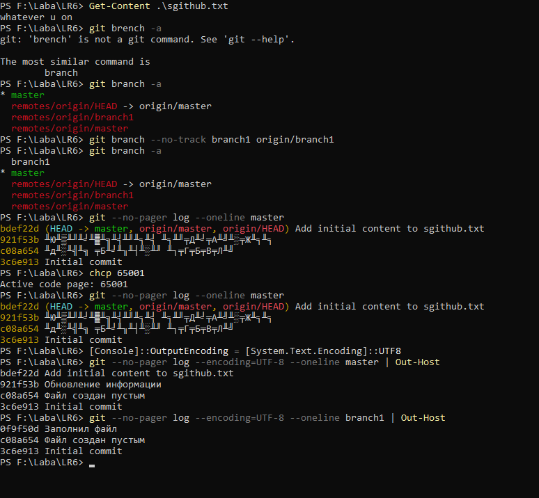
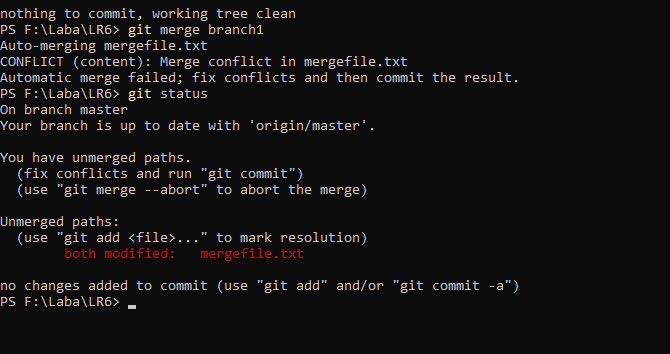
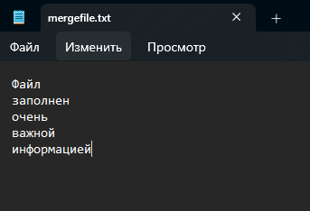
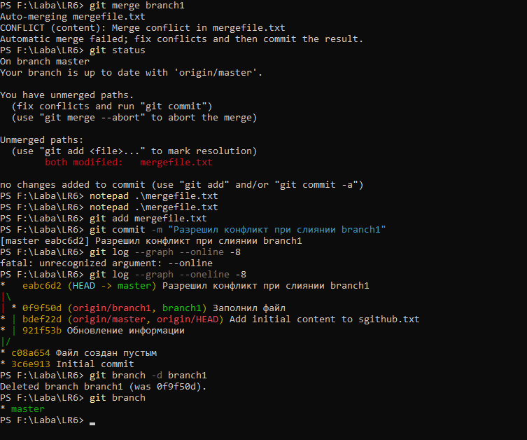
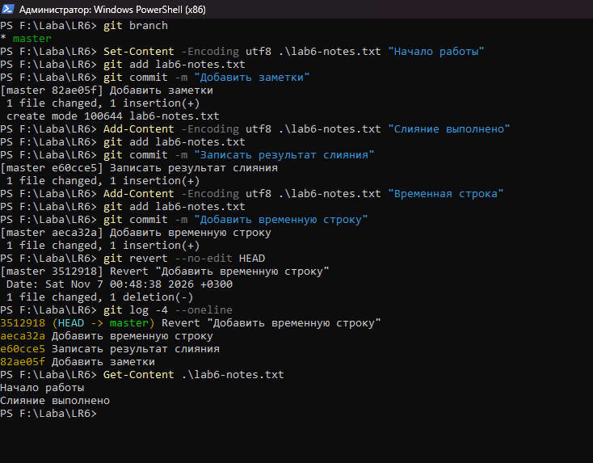

# Лабораторная работа № 6. Система контроля версий Git

**Далинчук М. В. · группа 4515**

[Мой форк LR6](https://github.com/krizibtw/LR6) · [Учебный репозиторий](https://github.com/Kurtyanik/LR6)

Цель работы — освоить основные команды Git, синхронизацию с GitHub, работу с ветками, разрешение конфликта слияния и откат коммита.

## Ход работы

### 1. Клонирование и синхронизация

Создал форк учебного репозитория с ветками `master` и `branch1` и клонировал его на компьютер. Настроил имя и почту автора для локального репозитория. Через `git remote -v` проверил, что `origin` указывает на мой форк.

Через сайт GitHub добавил в `master` файл `sgithub.txt`. Команда `git pull --ff-only` подтянула коммит `bdef22d` в локальную ветку. После обновления вывел содержимое файла в PowerShell.

### 2. История веток и просмотр изменений

Команда `git branch -a` показала ветку `origin/branch1`. На её основе создал локальную `branch1` и просмотрел историю обеих веток. Через `git show` проверил, что последний коммит `master` добавляет `sgithub.txt`, а последний коммит `branch1` заполняет `mergefile.txt`.



### 3. Слияние и удаление ветки

Из ветки `master` запустил `git merge branch1`. Git остановил слияние, поскольку обе ветки изменили `mergefile.txt`. Команда `git status` отметила файл как `both modified`.



Открыл файл в Блокноте и оставил текст из `master`. Сохранил исправленный файл, добавил его через `git add mergefile.txt` и завершил слияние коммитом `eabc6d2`.



Граф истории показал, что обе линии сходятся в коммите слияния. После проверки удалил локальную `branch1`. В выводе `git branch` осталась ветка `master`.



### 4. Коммиты и откат

В `master` создал `lab6-notes.txt` и сделал три коммита. Последний добавил строку «Временная строка». Команда `git revert --no-edit HEAD` создала коммит `3512918`, который отменил добавление этой строки. Проверил историю и содержимое файла. В файле остались строки «Начало работы» и «Слияние выполнено».



Отчёт оформлен в `README.md` для отдельной ветки `report`. Снимки экрана хранятся в каталоге `screenshots`.

## Лог команд

В команде настройки почты `<email>` обозначает адрес автора.

```powershell
cd 'F:\Laba'
git clone https://github.com/krizibtw/LR6.git
cd LR6
git config --local user.name "4515 Далинчук М.В."
git config --local user.email "<email>"
git remote -v
git switch master
git pull --ff-only
Get-Content .\sgithub.txt

git branch -a
git branch --no-track branch1 origin/branch1
git branch -a
chcp 65001
[Console]::OutputEncoding = [System.Text.Encoding]::UTF8
git --no-pager log --encoding=UTF-8 --oneline master | Out-Host
git --no-pager log --encoding=UTF-8 --oneline branch1 | Out-Host
git --no-pager show --encoding=UTF-8 master | Out-Host
git show branch1

git status
git merge branch1
git status
notepad .\mergefile.txt
git add mergefile.txt
git commit -m "Разрешил конфликт при слиянии branch1"
git log --graph --oneline -8
git branch -d branch1
git branch

Set-Content -Encoding utf8 .\lab6-notes.txt "Начало работы"
git add lab6-notes.txt
git commit -m "Добавить заметки"
Add-Content -Encoding utf8 .\lab6-notes.txt "Слияние выполнено"
git add lab6-notes.txt
git commit -m "Записать результат слияния"
Add-Content -Encoding utf8 .\lab6-notes.txt "Временная строка"
git add lab6-notes.txt
git commit -m "Добавить временную строку"
git revert --no-edit HEAD
git log -4 --oneline
Get-Content .\lab6-notes.txt

git switch -c report
git add -- README.md
git commit -m "Подготовить текст отчёта"
git add -- screenshots
git commit -m "Добавить скриншоты лабораторной работы"
git --no-pager log --encoding=UTF-8 --format="%h | %as | %an | %s" | Out-Host
```

## История коммитов

Поля идут в порядке из задания — сокращённый хэш, дата, имя автора и сообщение.

```text
ca346e4 | 2026-11-07 | 4515 Далинчук М.В. | Добавить скриншоты лабораторной работы
e777b36 | 2026-11-07 | 4515 Далинчук М.В. | Подготовить текст отчёта
3512918 | 2026-11-07 | 4515 Далинчук М.В. | Revert "Добавить временную строку"
aeca32a | 2026-11-07 | 4515 Далинчук М.В. | Добавить временную строку
e60cce5 | 2026-11-07 | 4515 Далинчук М.В. | Записать результат слияния
82ae05f | 2026-11-07 | 4515 Далинчук М.В. | Добавить заметки
eabc6d2 | 2026-11-07 | 4515 Далинчук М.В. | Разрешил конфликт при слиянии branch1
bdef22d | 2026-11-06 | krizi | Add initial content to sgithub.txt
921f53b | 2020-11-21 | Kurtyanik | Обновление информации
0f9f50d | 2020-11-21 | Kurtyanik | Заполнил файл
c08a654 | 2020-11-21 | Kurtyanik | Файл создан пустым
3c6e913 | 2020-11-21 | Kurtyanik | Initial commit
```

## Вывод

Я синхронизировал локальную копию с GitHub, просмотрел историю веток и вручную разрешил конфликт при слиянии. Команда `git revert` позволила отменить изменение отдельным коммитом, сохранив историю работы.
